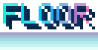

<p align="center"></p>

<h1 align="center">Make your README move.</h1>
<p align="center">Create bold pixel-art text as editable SVGs, with custom gradients and animation.</p>

<p align="center"><a href="https://iamangusu.github.io/pixel-banner/"></a></p>

<p align="center"><a href="README.de.md"></a></p>

<p align="center">
  <a href="https://www.npmjs.com/package/@iamangusu/pixel-banner"></a>
  <a href="LICENSE"></a>
</p>

<p align="center"><a href="#gallery">Gallery</a> · <a href="#quick-start">Quick start</a> · <a href="#cli-options">CLI options</a> · <a href="#terminal">Terminal</a> · <a href="#license">License</a></p>

## Gallery

| Neon · reveal and shimmer | Fire | Wave |
|:---:|:---:|:---:|
|  |  |  |

| Gradient floor | Light mint | Classic neon |
|:---:|:---:|:---:|
|  |  |  |

## Quick start

Make an SVG with Node.js 18+—no global install needed:

```sh
npx --yes @iamangusu/pixel-banner "HELLO" --preset neon --animation reveal+shimmer --colors "#24D6C8,#39A7FF,#C879FF" --out hello.svg
```

Use one or more comma-separated colors to choose the number of gradient stops. Then embed the SVG:

```md

```

Every generated SVG includes a hidden source comment linking to this repository.

The pixel font covers every printable ASCII keyboard character, plus common German keys such as `§`, `€`, `°`, and `²`. Accented Latin letters use their base letter (for example, `ä` becomes `A`); unsupported scripts and emoji use `?`.

## CLI options

Run `pixel-banner --help` for the short version. The full reference is below; defaults are shown in **bold** and apply unless a preset overrides them.

### Text, output, and presets

| Flag | What it does |
|---|---|
| `TEXT` | Text to render. Unsupported characters use the `?` glyph. |
| `-o, --out FILE` | Write SVG to a file. Without it, SVG is printed to stdout. |
| `-p, --preset NAME` | Start from a built-in look: `aiphone`, `neon`, `fire`, `mono`, `floor`, `reveal`, `light`, `light-sun`, `light-mint`, or `light-ink`. Other flags can override preset values. |
| `-h, --help` | Show command help. |

### Shape and depth

| Flag | Default | What it does |
|---|---:|---|
| `--scale N` | **8** | Output pixels per pixel-font cell. Larger values make the SVG physically larger without changing its design. |
| `--glyph-width N` | **100** | Glyph width in percent; `60` is narrow, `140` is wide. |
| `--weight N` | **1** | `1` is the original thin font; `2` thickens each glyph. |
| `--depth N` | **3** | Number of diagonal 3D extrusion layers, measured in pixel-font cells. `0` makes flat text; higher values make a deeper shadow. The web slider covers `0–8`; the CLI accepts larger non-negative integers too. |
| `--spacing N` | **1** | Empty cells between letters. `0` joins them; larger values add space. |
| `--padding N` | **1** | Empty cells around the banner. |
| `--taper` | off | Progressively narrows letters toward the end, by up to 28%. |

### Color, background, and animation

| Flag | Default | What it does |
|---|---:|---|
| `--colors "HEX,HEX,..."` | **`#5B6CFF,#A66BFF`** | Set one or more gradient stops. Add more comma-separated colors for more stops; one color makes a solid fill. |
| `--vertical` | off | Run the gradient top to bottom instead of left to right. |
| `--shadow HEX` | **`#2B2A6B`** | Set the 3D extrusion color. |
| `--highlight N` | **0.25** | Strength of the light top edge, from `0` (off) to `1` (full). |
| `--bg HEX` | none | Paint a solid background behind the text. |
| `--transparent` | off | Keep the SVG background transparent, even if `--bg` is also set. |
| `--light` | off | Tune contrast for a light page and use a transparent background unless `--bg` is supplied. |
| `--dark` | — | Turn light-page styling off, useful when overriding a `light-*` preset. |
| `--animation NAME` | **`none`** | Choose `none`, `wave`, `shimmer`, `blink`, `floor`, or `reveal`. Combine effects with `+`, for example `reveal+shimmer`. |
| `--footer` | off | Add a visible “powered by” credit and repository link below the banner. |

### Terminal output

| Flag | What it does |
|---|---|
| `--ansi` | Print a static, 24-bit color version in the terminal. |
| `--tui` | Play terminal animations; press Ctrl+C to stop. |
| `--live` | Open the interactive live studio. Type your text, then press Tab to edit presets, animation, colors, depth, size, spacing, shadow, background, and other output options with an instant preview. Press Enter to finish from text mode, Ctrl+S from settings, or Ctrl+C to cancel. Add `-o FILE` to choose an SVG output path. |
| `--width N` | Set terminal wrapping width for `--ansi`, `--tui`, or `--live`. By default the current terminal width is used. |

The web generator also updates its SVG preview as you type and as you change controls. Its depth slider ranges from `0` (flat) to `8` (deep extrusion).

## Terminal

Print the pixel-art banner in color:

```sh
npx --yes @iamangusu/pixel-banner "PIXEL-BANNER" --preset neon --ansi
```

Play the reveal and color shimmer live:

```sh
npx --yes @iamangusu/pixel-banner "PIXEL-BANNER" --preset neon --animation reveal+shimmer --tui
```

Open the live studio. Type your banner, press Tab to tune the options, and watch the preview update as you go:

```sh
npx --yes @iamangusu/pixel-banner --live
```

In settings, use Up/Down to select an option, Left/Right to change choices and numbers, and Enter to edit values such as colors or the output path. Press Tab to return to text. You can also start with text and flags, for example `pixel-banner "HELLO" --live --preset neon`.

Long terminal banners wrap automatically to the available width. Set `--width 100` to choose a limit yourself.

For frequent use, install it once:

```sh
npm install --global @iamangusu/pixel-banner
pixel-banner "PIXEL-BANNER" --preset neon --animation reveal+shimmer --tui
```

## Icon Marquee

<p align="center"><a href="https://github.com/IamAngusU/icon-marquee"></a></p>

## License

[MIT](LICENSE)
